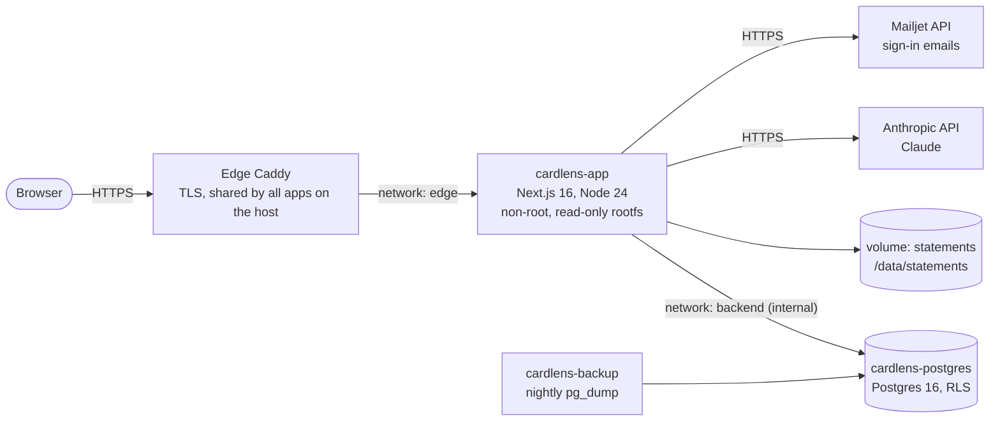
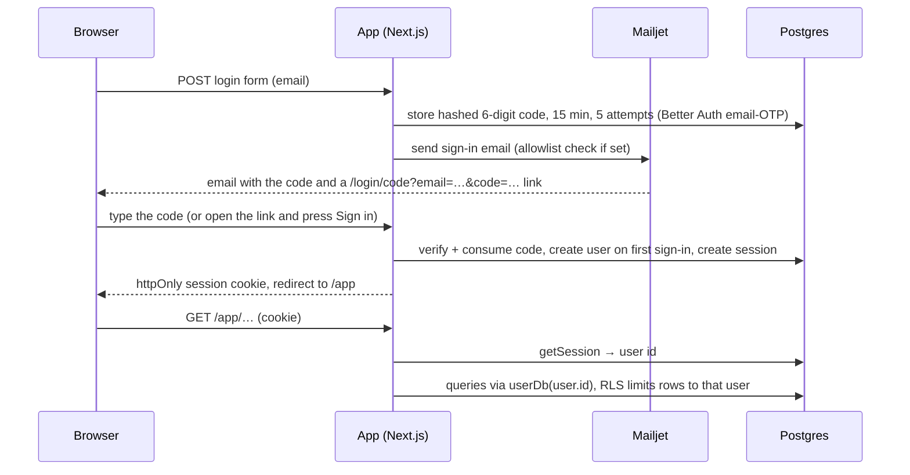
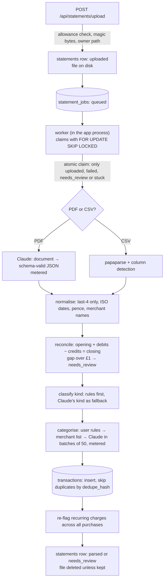
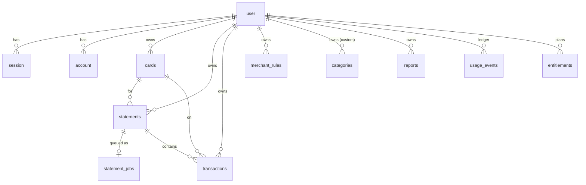
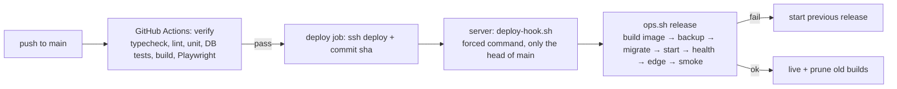

# Cardlens: architecture

One Next.js app with its own Postgres, run as a Docker compose stack on a shared VPS behind a Caddy edge proxy.
What the product does: [PRD.md](PRD.md). How it looks: [DESIGN.md](DESIGN.md). How to deploy and operate:
[runbooks/deploy.md](runbooks/deploy.md). Why not Supabase: [adr/0001](adr/0001-self-hosted-postgres-instead-of-supabase.md).

## 1. System overview



- The browser talks only to our origin. No third-party scripts, fonts are self-hosted, CSP `connect-src 'self'`.
- Postgres sits on an internal network with no route out. Only the app container joins the shared `edge` network.
- Claude reads statement PDFs and writes summary text. Mailjet sends magic links. Both are called only from the server.

## 2. Code layout

```
src/app/                    Next.js App Router
  page.tsx                  landing page (+ waitlist form → actions/waitlist.ts)
  login/                    magic-link request form
  app/                      signed-in area: overview, upload, statements, transactions, insights, report, settings
                            (pages are server components; mutations are server actions in */actions.ts)
  api/auth/[...all]/        Better Auth endpoints (magic-link verify, sign-out, session)
  api/statements/upload/    POST multipart → disk + statements row
  api/statements/[id]/process/  POST → runs the pipeline for one statement (up to 300 s)
  api/export/transactions/  GET → CSV
  healthz/                  liveness + database check
src/lib/
  db/index.ts               pg pool, userDb(userId) (RLS-scoped), anonDb
  auth.ts, session.ts       Better Auth config; getUser(), requireUser()
  storage.ts                statement files on disk, owner-checked paths, magic-byte sniffing
  usage.ts                  upload/AI allowances, token ledger, IP rate limits
  mail.ts, email/           Mailjet sender, sign-in email template
  pipeline/                 csv, normalise, classify, reconcile, dedupe, recurring, transform (pure); run.ts (DB + IO)
  ai/                       Claude client, PDF extraction, merchant categorising
  analytics.ts              every number in Overview, Insights and the report
  summary/                  report text: generate (Claude), validate (£ figure check), template (fallback)
src/prompts/                system prompts for extraction, categorising, annual summary
src/data/merchant-aliases.json   ~200 UK merchants → name + category
db/migrations/              plain SQL, applied once each by scripts/migrate.mjs
deploy/                     compose stack, edge site, ops.sh, deploy hook, setup and deploy scripts, stack test
tests/unit, tests/db, tests/e2e
```

Pure logic (pipeline, analytics, summary validation) has no database or network access, so it is unit-tested
directly. Database behaviour (RLS, caps, pipeline on Postgres) is covered by `tests/db`, and user journeys by
Playwright (`tests/e2e`).

## 3. Request and auth flow



- `src/proxy.ts` only redirects `/app` to `/login` when no session cookie exists. Every page, action and API route
  checks the session itself (`requireUser()` / `getUser()`).
- Sessions are database-backed (Better Auth `session` table); signing out or deleting the account ends them.
- The link in the email only pre-fills the code: signing in needs a click, so mail scanners that open links can't
  use up the code. Codes are stored hashed. Old magic links (sent before the switch) are no longer accepted.

## 4. Statement pipeline



- Processing runs in the background. Upload enqueues a job; a worker started from `src/instrumentation.ts`
  (`WORKER_CONCURRENCY` loops, default 2) claims jobs from `statement_jobs` with `FOR UPDATE SKIP LOCKED`, so
  closing the browser doesn't stop a file. Jobs left `running` for 10 minutes (a restart mid-file) are claimed
  again; after 3 attempts the statement is marked failed. The uploader and Statements page poll
  `GET /api/statements/status`. `POST /api/statements/:id/process` now only re-queues a file (Retry).
- Each step before the database is pure (`src/lib/pipeline/*`). `run.ts` wires them together with the database and disk.
- The statement is claimed with one `UPDATE … RETURNING`, so a parsed or in-flight statement can't run twice.
- Errors written for users (`UserError`, `LimitError`) are shown; anything else is logged and replaced with a
  generic message.
- The annual report computes `Metrics` in `analytics.ts` and sends only those aggregates (no transaction
  descriptions or card data) to Claude. `summary/validate.ts` rejects any £ figure not derivable from the
  metrics, retries once, then falls back to `summary/template.ts`.

## 5. Data model



| Table | Purpose |
|---|---|
| `user`, `session`, `account`, `verification` | Better Auth (uuid ids). Deleting a user cascades to every table below |
| `cards` | issuer, nickname, last 4 digits |
| `statements` | one uploaded file: status, period, balances, reconciliation result, file path (null once deleted) |
| `transactions` | one line: date, merchant, amount in pence (always positive) + direction, kind, category, business and recurring flags, `dedupe_hash` (unique per user) |
| `categories` | system categories (shared, read-only) and user-made ones |
| `merchant_rules` | "this pattern is this merchant / category / business": applied on future imports |
| `reports` | one per user and period (`period_key`: `2026`, `tax-2025`, `m-2025-11`): metrics JSON, summary JSON, model, AI or template |
| `entitlements` | paid plans: plan, status, Stripe ids (unique), period end. The app can insert and update, not delete |
| `stripe_events` | ids of processed Stripe webhook events (idempotency) |
| `statement_jobs` | background processing queue, one row per statement (no RLS; only the worker and owner-checked routes touch it) |
| `waitlist` | landing-page sign-ups (insert-only for the app) |
| `usage_events` | append-only ledger: uploads and Claude calls with token counts |
| `rate_limits` | fixed-window counters keyed by hashed IP |
| `schema_migrations` | applied migration files |

All money is whole pence (`bigint`). Dates are `date` and are returned to the app as `yyyy-mm-dd` strings.

## 6. Security model
- **Row-level security** on every user table. Policies compare `user_id` with `app.current_user_id()`, which
  reads `app.user_id`. The app connects as `cardlens_app`, which doesn't own the tables, so RLS applies.
  `userDb(userId)` runs each query in a short transaction with `set_config('app.user_id', …, true)`. `anonDb` sees
  no user rows. `tests/db/rls.test.ts` proves isolation between users.
- **Least privilege:** the app can't read the waitlist, and can't update or delete the usage ledger.
- **Files:** paths must match `<user_id>/<uuid>.(pdf|csv)` for the signed-in user. Type is checked by magic bytes.
  Files are mode 0600 on a volume only the app mounts.
- **Spend control:** per-user upload and AI allowances, plus a global daily AI cap, all counted in the
  append-only ledger. Claude errors are metered too.
- **Abuse:** Better Auth rate-limits code requests (5 per hour per IP and per email) and code checks (10 per 15 minutes); each code allows 5 attempts. The waitlist has a honeypot and
  5 per hashed IP per hour.
- **Data handling:** card numbers are cut to the last 4 digits, statement files are deleted after parsing, no
  raw IPs are stored, and logs never contain email addresses, tokens or statement content.
- **Headers:** strict CSP, HSTS (preload), `X-Frame-Options: DENY`, `nosniff`, a restrictive Permissions-Policy.

## 7. Plans and payments

- **Plans** live in `src/lib/plans.ts`: Free, Annual Report (£9 one-off, 12 months) and Side-Business (£29 a year).
  Free covers upload, reconciliation, statements, transactions, the overview and a report preview. Insights, the
  full report, PDF and CSV export need a paid plan; business/personal split and up to 3 cards need Side-Business.
- **One check:** pages and actions call `getAccessCached()` → `access.can(feature)`. Actions and API routes enforce
  it on the server too (`assertCan`, 403 `upgrade_required`).
- **`PAYMENTS_ENABLED=false`** (the default) gives everyone every feature and hides checkout, so the live site
  behaves as before until the owner switches it on.
- **Checkout:** `/app/billing` → server action creates a Stripe Checkout session (payment mode for £9,
  subscription for £29) with `metadata.user_id` and `plan`, and the 14-day cancellation acknowledgement.
  Billing Portal handles cards, invoices and cancelling.
- **Webhook** `POST /api/stripe/webhook`: verifies the signature, skips event ids already in `stripe_events`,
  turns the event into one change (`src/lib/billing/events.ts`, pure and unit-tested) and upserts `entitlements`
  keyed by Stripe ids, so replays and out-of-order events are safe. Subscription events re-read the subscription
  from Stripe. A full refund of the £9 payment ends access.
- Deleting all data cancels any live subscription first. Everyone can download all their data as JSON for free
  (UK GDPR), even though CSV export is paid.

## 8. Deployment and CI/CD



- `scripts/verify.sh` is CI and the local pre-push check: the same commands in both places.
- The deploy key can only run `deploy-hook.sh`. The hook downloads the commit from GitHub itself and refuses
  anything that isn't the current head of `main`.
- Releases are serialised with a lock. Migrations must be backward-compatible, so a rollback to the previous
  image keeps working.
- Backups: a nightly dump (kept 14 days) plus one before every migration, on the server. Off-server copies are
  still open.

## 9. Configuration
All settings are environment variables, listed and explained in [`.env.example`](../.env.example). On the
server they live in `/opt/cardlens/stack/.env` (created by `deploy/setup-vps.sh`, never committed).
`SITE_URL` and every other setting is read at runtime, so one image runs anywhere.

## 10. Known limits
- One app instance. The Better Auth rate limiter and the database pool are per process, which is fine at this
  scale. More instances would need a shared rate-limit store.
- The worker runs inside the single app process; more instances would each run a worker (safe, thanks to
  `SKIP LOCKED`), but there is no separate worker container yet.
- Reports cover a calendar year, a UK tax year (6 April – 5 April) or any 12 months from a chosen month. GBP only.
- Migration 0003 replaced the reports `(user_id, year)` unique key with `(user_id, period_key)`. Rolling back to
  the release before it still serves pages, but generating a report there fails until rolled forward again.
- Dark-mode tokens exist but nothing switches them on (see DESIGN.md).
